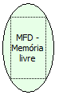

Descrição:

Retorna o percentual livre da Memória Fita Detalhe (MFD) no formato XX,XX% (com a virgula e o %).

Parâmetros:

Não possui

Retorno:

Memória livre

Nome Real:

ebfBematechFiscalMFDFreeMemory

Compatibilidade:

Cliente
