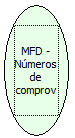

Descrição:

Retorna o número de comprovantes não fiscais não emitidos.

Parâmetros:

Não possui

Retorno:

Número de Comprovantes

Nome Real:

ebfBematechFiscalMFDNoEmittedVouchers

Compatibilidade:

Cliente
