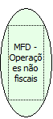

Descrição:

Retorna o número de operações não fiscais canceladas.

Parâmetros:

Não possui

Retorno:

Número de operações não fiscais canceladas.

Nome Real:

ebfBematechFiscalMFDCanceledOperationsNoFiscal

Compatibilidade:

Cliente
