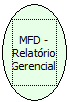

Descrição:

Retorna os relatórios gerenciais programados e seus valores acumulados.

Parâmetros:

Não possui

Retorno:

Relatórios

Nome Real:

ebfBematechFiscalMFDManagerialReport

Compatibilidade:

Cliente
