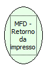

Descrição:

Lê o retorno estendido da impressora (ACK, ST1, ST2 e ST3) referente ao último comando enviado.

Parâmetros:

Não possui

Retorno:

Lista de retorno (ACK, ST1, ST2, ST3)

Observações:

1. Essa função deve ser usada após a execução de qualquer outra função da dll para ler o retorno da impressora referente à função executada. Essa função devolve o status da impressora (pouco papel, comando não executado, tipo de parâmetro de CMD inválido etc.).

2. O ST3 só será retornado, caso seja habilita o retorno estendido na impressora com a função ''.

Nome Real:

ebfBematechFiscalMFDPrinterReturn

Compatibilidade:

Cliente
