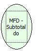

Descrição:

Retorna o subtotal do comprovante não fiscal não vinculado (recebimento).

Parâmetros:

Não possui.

Retorno:

Subtotal

Nome Real:

ebfBematechFiscalMFDVerifyingSubtotal

Compatibilidade:

Cliente
