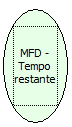

Descrição:

Retorna o tempo restante do relatório gerencial ou do comprovante não-fiscal aberto. Este tempo é retornado em segundos e o limite destes comprovantes é de 2 minutos.

Parâmetros:

Não possui

Retorno:

Tempo

Observação:

Função disponível para a impressora fiscal térmica MP-2000 TH FI versão 01.00.02 ou 01.01.01.

Nome Real:

ebfBematechFiscalMFDRemainingTime

Compatibilidade:

Cliente
