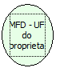

Descrição:

Retorna a UF do proprietário cadastrada na impressora.

Parâmetros:

Não possui

Retorno:

UF

Observação:

Função disponível para a impressora fiscal térmica MP-2000 TH FI versão 01.00.02 ou 01.01.01.

Nome Real:

ebfBematechFiscalMFDProprietaryUF

Compatibilidade:

Cliente
