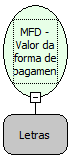

Descrição:

Retorna o valor acumulado em uma determinada forma de pagamento.

Parâmetros:

1.  Forma de pagamento

Retorno:

Valor da forma de pagamento

Nome Real:

ebfBematechFiscalMFDValuePaymentForm

Compatibilidade:

Cliente
