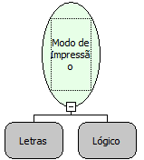

Descrição:

Modifica o modo de trabalho da impressora.

Parâmetros:

1. O modo de impressão que deseja imprimir.

2. Valor lógico de ativação do modo de impressão.

Retorno:

Letras

Observações:

1. Existem os seguintes modos de Impressão:

    NORMAL: Modo normal de impressão 48 colunas por linha.

    CONDENSADO ou COMPRIMIDO: Modo condensado 54 colunas por linha.

    ELITE: Modo ELITE 36 Colunas por linha.

    EXPANDIDO 18, 24 e 27 colunas.

    ITÁLICO ou ITALICO: Imprime os caracteres em Itálico, podendo ser combinados com outros modos de impressão.

    SUBLINHADO: Sublinhado.

    ENFATIZADO: Coloca os caracteres em negrito.

2. Para colocar a impressora no modo normal basta chamar esta rotina definindo o modo  'NORMAL' como Falso.

Exemplos:

 Parâmetro 1 : CONDENSADO (Modo de Impressão)

 Parâmetro 2 : Falso (Valor Lógico)

 Retorno : Caractere de Controle

Nome Real:

ebfBematechPrinterMode

Compatibilidade:

Cliente e Servidor
