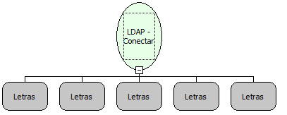

Descrição:

Autentica um usuário via LDAP.

Parâmetros:

1. Servidor

2. Porta

3. Domínio

4. Usuário

5. Senha

Retorno:

Retorna a conexão LDAP se a autenticação foi efetuada com sucesso. Caso contrário, retorna Nulo. Caso o Servidor ou a Porta estejam incorretos, um erro será lançado.

Exemplo:

Servidor: authserv

Porta: 389

Domínio: softwell.local

Usuário: maker

Senha: 1

Nome Real:

ebfLDAPConnect

Compatibilidade:

Servidor
