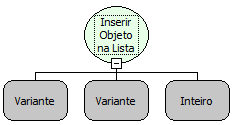

Descrição:

Essa função insere um elemento numa lista, podendo indicar a sua posição na lista.

Parâmetros:

1. Objeto Lista

2. Elemento a ser inserido

3. Inteiro indicando a posição do elemento na Lista ou nulo indicando inclusão no final da lista (OPCIONAL)

Retorno:

Lista atualizada. O retorno da função pode ser armazenado numa variável do tipo variante.

Exemplos:

1. Assumindo que o 1º parâmetro seja uma lista com os seguintes valores: &#123;a, b, c, d, e, f, g, h&#125;, o 2º parâmetro "s" e o 3º parâmetro NULO. O retorno será uma lista com os seguintes valores: &#123;a, b, c, d, e, f, g, h, s&#125;. Como não indicou a posição do elemento, ele é inserido na ultima posição da lista.

2. Assumindo que o 1º parâmetro seja uma lista com os seguintes valores: &#123;v, y, d&#125;, o 2º parâmetro "u" e o 3º parâmetro 2. O retorno será uma lista com os seguintes valores: &#123;v, u, y, d&#125;. Como o 3º parâmetro determina a posição do elemento na lista, ele será inserido na posição 2 da lista.

Nome Real:

ebfSetElementAtList

Compatibilidade:

Cliente e Servidor
