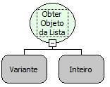

Descrição:

Essa função busca e retorna o elemento, que deseja obter, a partir da sua posição na lista.

Parâmetros:

1. Objeto Lista

2. Posição do elemento na lista que deseja obter

Retorno:

Elemento correspondente à posição, passada no 2º parâmetro, na lista. O retorno da função pode ser armazenado numa variável do tipo variante.

Exemplos:

1. Assumindo que o 1º parâmetro seja uma lista com os seguintes valores: &#123;a, b, c, d, e, f, g, h&#125;, o 2º parâmetro seja 3. O retorno será "c", pois o elemento que está na posição 3 da lista é o "c".

2. Assumindo que o 1º parâmetro seja uma lista com os seguintes valores: &#123;2, 5, 8, 9&#125;, o 2º parâmetro seja 1. O retorno será "2", pois o elemento que está na posição 1 da lista é o "2".

Nome Real:

ebfGetElementFromList

Compatibilidade:

Cliente e Servidor
