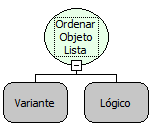

Descrição:

Essa função ordena os elementos de uma lista.

Parâmetros:

1. Objeto Lista

2. Valor Lógico

Retorno:

Lista ordenada. O retorno da função pode ser armazenado numa variável do tipo variante.

Exemplos:

1. Assumindo que o 1º parâmetro seja uma lista com os seguintes valores: &#123;a, d, b, e, h, f, g, c&#125;, o 2º parâmetro seja "True". O retorno será uma lista ordenada de forma ascendente com os seguintes valores: &#123;a, b, c, d, e, f, g, h&#125;.

2. Assumindo que o 1º parâmetro seja uma lista com os seguintes valores: &#123;1, 2, 3&#125;, o 2º parâmetro seja "False". O retorno será uma lista ordenada de forma descendente com os seguintes valores: &#123;3, 2, 1&#125;.

Nome Real:

ebfListSort

Compatibilidade:

Servidor
