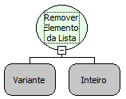

Descrição:

Essa função busca o elemento, que deseja obter, a partir da sua posição na lista e o remove do mesmo.

Parâmetros:

1. Objeto Lista

2. Posição do elemento na lista que será removido

Retorno:

Elemento removido da lista. O retorno da função pode ser armazenado numa variável do tipo variante.

Exemplos:

1. Assumindo que o 1º parâmetro seja uma lista com os seguintes valores: &#123;a, b, c, h&#125;, o 2º parâmetro seja 4. O retorno será o elemento "h" removido da lista, pois o elemento que está na posição 4 da lista é o "h".

2. Assumindo que o 1º parâmetro seja uma lista com os seguintes valores: &#123;56, 26, 95, 62&#125;, o 2º parâmetro seja 2. O retorno será o elemento "26" removido da lista, pois o elemento que está na posição 2 da lista é o "26";.

Observação:

1. Ao utilizar esta função num fluxo do tipo cliente, é necessário atribuir o retorno da mesma à lista cujo elemento se

deseja remover.

- A função quando executada no cliente retorna a lista resultante após a remoção do objeto desejado.
- A função quando executada no servidor retorna o objeto removido.

Nome Real:

ebfRemoveElementFromList

Compatibilidade:

Cliente e Servidor
