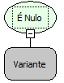

Descrição:

Essa função verifica se o parâmetro é nulo. A depender do resultado, retorna verdadeiro ou falso.

Parâmetros:

1. Recebe um valor ou uma função para ser avaliada.

Retorno:

Retorna verdadeiro se o valor for nulo, caso contrário o retorno será falso.

Exemplos:

1. Assumindo que tenhamos feito uma consulta no banco de dados (ex: FPG_ACUMULO) e a partir da consulta obtemos o valor do campo (FOL_COD). Atribuindo essas duas funções a função É Nulo, caso a consulta não retorne valor de FOL_COD o retorno será verdadeiro, pois o campo está com o valor nulo.

2. Assumindo que tenhamos obtido o valor de um componente do formulário, se não tiver valor no componente o retorno será verdadeiro, caso o componente tenha algum valor atribuído a ele o retorno será falso.

Nome Real:

isNull

Compatibilidade:

Cliente e Servidor
