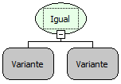

Descrição:

Essa função verifica se os valores passados por parâmetro são iguais, ou seja, possuem o mesmo valor.

Parâmetros:

1. Valor a ser verificado

2. Valor a ser verificado

Retorno:

O Retorno será verdadeiro se o valor do 1º parâmetro for igual ao valor do 2º parâmetro, caso contrário o retorno será falso.

Exemplos:

1. Assumindo o valor do 1º parâmetro sendo "ab" e o 2º parâmetro sendo "AB" o valor de retorno será falso, pois a função diferencia letras maiúsculas e minúsculas.

2. Assumindo o valor do 1º parâmetro sendo "80" e o 2º parâmetro sendo "80" o valor de retorno será verdadeiro, pois 80 é igual a 80.

Observação:

Essa função diferencia letras maiúsculas e minúsculas. Devido a tipagem dinâmica das variáveis na camada cliente. Para que a função considere que os parâmetros são numéricos, será necessário converter os valores para número (inteiro ou fracionario) ao passar os parâmetros para a  função (mesmo se as variáveis utilizadas já forem numéricas).

Nome Real:

isEqual

Compatibilidade:

Todas as camadas
