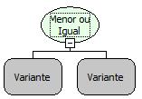

Descrição:

Essa função verifica se o valor do 1º parâmetro é menor ou igual ao valor do 2º parâmetro. A depender do resultado retorna verdadeiro ou falso.

Parâmetros:

1. Valor a ser verificado

2. Valor a ser verificado

Retorno:

Retorna verdadeiro se o valor do 1º parâmetro for menor ou igual ao valor do 2º parâmetro, caso contrário o retorno será falso.

Exemplos:

1. Assumindo o valor do 1º parâmetro sendo 65 e o 2º parâmetro sendo 15 o valor de retorno será falso, pois 65 não é menor nem igual que 15.

2. Assumindo o valor do 1º parâmetro sendo 505 e o 2º parâmetro sendo 632 o valor de retorno será verdadeiro, pois 505 é menor que 632.

3. Assumindo o valor do 1º parâmetro sendo 39 e o 2º parâmetro sendo 39 o valor de retorno será verdadeiro, pois a condição é maior ou igual e 39 é igual a 39.

Observação:

Devido a tipagem dinâmica das variáveis na camada cliente. Para que a função considere que os parâmetros são  numéricos, será necessário converter os valores para número (inteiro ou fracionario) ao passar os parâmetros para a função (mesmo se as variáveis utilizadas já forem numéricas).

Nome Real:

isMinorOrEqual

Compatibilidade:

Todas as camadas
