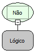

Descrição:

Essa função inverte o valor lógico. Se o valor do parâmetro for verdadeiro o retorno dele terá o valor lógico falso. Caso contrário será verdadeiro.

Parâmetros:

1.Valor Lógico

Retorno:

Retorna o valor lógico invertido.

Exemplos:

1. Assumindo que o 1º parâmetro é uma variável do tipo lógica de valor verdadeiro, o retorno será falso.

2. Assumindo que o 1º parâmetro é a função igual contendo os valores 5 e 5 (5=5) o retorno será falso, pois (5=5 é verdadeiro) a negação dessa operação é falso.

Nome Real:

oprNot

Compatibilidade:

Todas as camadas
