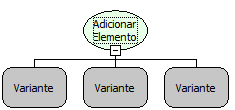

Descrição:

Essa função armazena um valor no objeto mapa passando como parâmetro a chave ou referencia do valor e o valor que deseja armazenar.

Parâmetros:

1. Objeto Mapa

2. Chave (ou Referência)

3. Valor a ser armazenado

Retorno:

Retorna o objeto mapa com o valor armazenado. O retorno pode ser armazenado numa variável do tipo variante.

Observação:

Para obter o valor armazenado é preciso utilizar a função "Obter Elemento" passando como parâmetro a chave ou referencia do valor.

Exemplo:

Assumindo o 1º parâmetro sendo MAPA, o 2º parâmetro sendo Maker e o 3º parâmetro sendo Flow, o retorno será o conteúdo Flow armazenado no objeto mapa "MAPA" com a sua chave de referencia sendo Maker.

Nome Real:

ebfMapAddObject

Compatibilidade:

Cliente e Servidor
