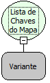

Descrição:

Essa função obtém todas as chaves ou referencias de um determinado objeto mapa.

Parâmetros:

1. Objeto Mapa

Retorno:

Retorna uma lista de chaves. O retorno deverá ser armazenado numa variável do tipo variante.

Exemplo:

Assumindo o 1º parâmetro contendo um objeto mapa com as seguintes chaves e respectivos valores: Maker/Flow; Freire/Softwell, Banco/SQL. A partir desses valores o retorno será uma lista com a chave do objeto mapa, que seria Maker, Freire e Banco.

Nome Real:

ebfMapKeys

Compatibilidade:

Cliente e Servidor
