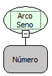

Descrição:

Obtém o arco seno ou o seno inverso de um número.  O arco seno é o ângulo cujo seno é o Parâmetro 1. O ângulo retornado é fornecido em radianos no intervalo de -pi/2 a pi/2. Se você quiser converter o resultado de radianos em graus, multiplique-o por 180/PI ou use a função Para Graus.

Parâmetros:

1. É o seno do ângulo desejado e deve estar entre -1 e 1.

Retorno:

Arco seno do ângulo determinado.

Exemplos:

Assumindo o Parâmetro 1 como -0,5 o retorno seria aproximadamente -0,5236.

Observações:

Para garantir a integridade das operações matemáticas, utilize conversão para o tipo de dado nos parâmetros.

Nome Real:

ebfMathArcSine

Compatibilidade:

Cliente e Servidor
