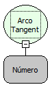

Descrição:

Obtém o arco tangente, ou a tangente inversa, de um número. O arco tangente é o ângulo cuja tangente é o Parâmetro 1. O ângulo retornado é fornecido em radianos no intervalo -pi/2 a pi/2. Caso queira converter o resultado de radianos em graus, multiplique-o por 180/PI ou use a função Para Graus.

Parâmetros:

1. É a tangente do ângulo desejado.

Retorno:

Arco tangente do ângulo determinado.

Exemplo:

Assumindo o Parâmetro 1 como 1 o retorno seria aproximadamente 0,785398.

Observações:

Para garantir a integridade das operações matemáticas, utilize conversão para o tipo de dado nos parâmetros.

Nome Real:

ebfMathArcTangent

Compatbilidade:

Cliente e Servidor
