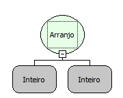

Descrição:

Obtém o cálculo do arranjo de um valor. Um arranjo ou permutação sem repetição é o cálculo de quantas maneiras diferentes é possível colocar d elementos de um conjunto com n elementos em seqüência, sem repetição. A fórmula do cálculo de um arranjo é a seguinte: n! / (n-d)!

Parâmetros:

1.  Corresponde à quantidade de elementos do conjunto (d na fórmula acima).

2.  Corresponde ào número de elementos em sequência, sem repetição (n na fórmula acima).

Retorno:

Cálculo do arranjo do valor determinado.

Observação:

Para garantir a integridade das operações matemáticas, utilize conversão para o tipo de dado nos parâmetros.

Nome Real:

ebfMathArrangement

Compatbilidade:

Cliente e Servidor
