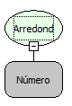

Descrição:

Obtém o valor inteiro de um número arredondando para cima ou para baixo, a depender da parte fracionada do número.

Se a parte fracionada do número for maior ou igual a 0,5 o número será arredondado para cima, caso contrário para baixo.

Parâmetros:

1. Valor a ser arredondado.

Retorno:

Retorna o valor (inteiro) arredondado de um número passado por parâmetro.

Exemplos:

1. Assumindo o parâmetro como: 9,5 , retorno seria: 10 (Inteiro).

2. Assumindo o parâmetro como: 9,4 , retorno seria: 9 (Inteiro).

Observação:

Para garantir a integridade das operações matemáticas, utilize conversão para o tipo de dado nos parâmetros.

Nome Real:

oprRound

Compatibilidade:

Cliente e Servidor
