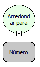

Descrição:

Arredonda um valor fracionado para cima.

Parâmetros:

1. Número a ser arredondado.

Retorno:

Valor arredondado para cima.

Exemplos:

1. Assumindo o Parâmetro 1 como 9,5 o retorno seria 10,0.

2. Assumindo o Parâmetro 1 como 5,4 o retorno seria 6,0.

Observação:

Para garantir a integridade das operações matemáticas, utilize conversão para o tipo de dado nos parâmetros.

Nome Real:

ebfMathCeil

Compatibilidade:

Cliente e Servidor
