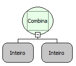

Descrição:

Uma combinação indica quantas variedades de subconjuntos diferentes com s elementos existem em um conjunto com n elementos. Só é usada quando não há repetição de membros dentro do conjunto. A fórmula de cálculo de uma combinação é a seguinte: n! / s! * (n - s)!

Parâmetros:

1. Quantidade de elementos do conjunto (corresponde ao n da fórmula acima).

2. Quantidade de elementos nos subconjuntos (corresponde ao s da fórmula acima).

Retorno:

Cálculo da combinação.

Exemplos:

1. Assumindo o Parâmetro 1 como 3 e o Parâmetro 2 como 2, o retorno seria 3.

2. Assumindo o Parâmetro 1 como 4 e o Parâmetro 2 como 2, o retorno seria 6.

Observação:

Para garantir a integridade das operações matemáticas, utilize conversão para o tipo de dado nos parâmetros.

Nome Real:

ebfMathCombination

Compatibilidade:

Cliente e Servidor
