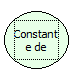

Descrição:

O número de Neper é a base dos logaritmos naturais.

Parâmetros:

Não possui.

Retorno:

Retorna a constante de Neper (2,718..).

Observação:

Para garantir a integridade das operações matemáticas, utilize conversão para o tipo de dado nos parâmetros.

Nome real:

ebfMathNeper

Compatibilidade:

Cliente e Servidor
