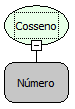

Descrição:

Obtém o cosseno de um ângulo. Se o ângulo estiver em graus, multiplique-o por PI/180 ou use a função Para Radianos para convertê-lo em radianos.

Parâmetros:

1. Ângulo em radianos cujo cosseno você deseja obter.

Retorno:

Cosseno do ângulo determinado.

Exemplos:

1. Assumindo o Parâmetro 1 como 1,047 o retorno seria 0,500171.

2. Assumindo o Parâmetro 1 como 60*PI/180 o retorno seria 0,5.

Observação:

Para garantir a integridade das operações matemáticas, utilize conversão para o tipo de dado nos parâmetros.

Nome Real:

ebfMathCosine

Compatibilidade:

Cliente e Servidor
