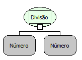
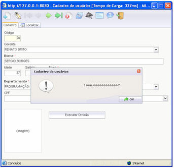
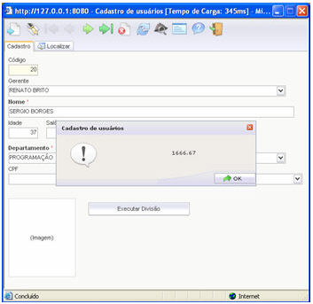

Descrição:

Essa função é utilizada para fazer a divisão.

Parâmetros:

1. Informar o valor do dividendo.

2. Informar o valor do divisor.

Retorno:

Resultado da divisão dos números passados por parâmetros.

Observações:

1. Não funciona no evento ao entrar e ao sair no componente grade em tipo servidor e cliente;

2. Não funciona no componente imagem em tipo cliente servidor e cliente;

3. Não funciona no evento ao sair no formulário em tipo servidor e cliente;

4. Não funciona no evento ao preencher a lista no componente lista dinâmica em tipo cliente e servidor;

5. Essa função aceita só dois parâmetros.

Exemplos:

1. Assumindo os parâmetros como: 10 (Inteiro), 5 (Inteiro), o retorno seria : 2,0 (Fracionado).

2. Assumindo os parâmetros como: 10,5 (Fracionado), o 2,5(Fracionado), o retorno seria: 4,2 (Fracionado) .

Nome Real:

sqlDivide

Compatibilidade:

Todas as camadas

Características da Função Divisão

A função Divisão está localizada na categoria Matemática. Quando um valor fracionado for dividido por um inteiro, o resultado, como vem da própria API do JAVA ou JAVASCRIPT, é apresentado com uma formatação não convencional. Para que tenha o efeito que o usuário quer, é recomendado utilizar a função Arredondar Casas Decimais.

Exemplo:

Com a função Arredondar casas decimais:

