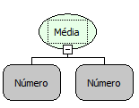

Descrição:

Calcula a média aritmética dos valores passados como parâmetro.

Parâmetros:

n. Valor a ser somado.

Retorno:

Retorna a divisão da soma dos números passados por parâmetro pela quantidade de parâmetros.

Exemplos:

1. Informando os parâmetros como: 10 (Inteiro) e 2 (Inteiro), o resultado é 6,0 (Fracionado).

2. Informando os parâmteros como: 7 (Inteiro), 7 (Inteiro) e 7 (Inteiro) o resultado é 7,0 (Fracionado).

Observação:

Para garantir a integridade das operações matemáticas, utilize conversão para o tipo de dado nos parâmetros.

Nome Real:

oprAverage

Compatibilidade:

Cliente e Servidor
