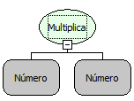

Descrição:

Retorna a multiplicação dos números passados por parâmetro.

Parâmetros:

n.Valor a ser multiplicado.

Retorno:

Resultado da multiplicação dos parâmetros passados.

Exemplo:

Assumindo os valores dos parâmetros 5 (Inteiro) e 4 (Inteiro), o retorno seria 20 (Inteiro).

Observação:

Para garantir a integridade das operações matemáticas, utilize conversão para o tipo de dado nos parâmetros.

Nome Real:

oprMultiply

Compatibilidade:

Todas as camadas
