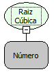

Descrição:

Obtém a raiz cúbica de um valor.

Parâmetros:

1. Valor a ser avaliado.

Retorno:

Raiz cúbica do valor determinado.

Exemplo:

Assumindo o Parâmetro 1 como 8, o retorno seria 2.

Observação:

Para garantir a integridade das operações matemáticas, utilize conversão para o tipo de dado nos parâmetros.

Nome Real:

ebfMathCubeRoot

Compatibilidade:

Cliente e Servidor
