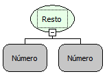

Descrição:

Calcula o resto da divisão de dois números.

Parâmetros:

1. Dividendo.

2. Divisor.

Retorno:

Retorna o resto da divisão do número do Parâmetro 1 com o número do Parâmetro 2.

Exemplo:

Assumindo os parâmetros como: 5 (Inteiro) e 2 (inteiro), o retorno seria: 1(Inteiro).

Observação:

Para garantir a integridade das operações matemáticas, utilize conversão para o tipo de dado nos parâmetros.

Nome Real:

oprMod

Compatibilidade:

Todas as camadas
