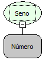

Descrição:

Obtém o seno de um ângulo. Se o parâmetro estiver em graus, multiplique-o por PI/180 ou use a função Para Radianos para convertê-lo em radianos.

Parâmetros:

Ângulo em radianos para o qual você deseja obter o seno.

Retorno:

Seno do ângulo determinado.

Exemplo:

Assumindo o Parâmetro 1 como PI, o retorno seria 0, aproximadamente.

Observação:

Para garantir a integridade das operações matemáticas, utilize conversão para o tipo de dado nos parâmetros.

Nome Real:

ebfMathSine

Compatibilidade:

Cliente e Servidor
