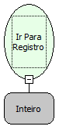

Descrição:

Vai para o registro definido no parâmetro.

Parâmetros:

1. Posição do registro

Observação:

O uso dessa função tem uma melhor performance quando usada em regras clientes.

Nome Real:

ebfNavGotoRecord

Compatibilidade:

Todas as camadas
