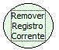

Descrição:

Remove o registro atual do formulário corrente.

Parâmetros:

Não possui.

Retorno:

Não possui.

Observação:

O uso dessa função tem uma melhor performance quando usada em regras clientes.

Nome Real:

ebfNavDeleteCurrentRecord

Compatibilidade:

Todas as camadas
