Descrição:

Essa função libera a ocorrência que foi bloqueada pelo semáforo apartir de um indentificador.

Parâmetros:

1. Identificador do semáforo (o mesmo utilizado para a aquisição do semáforo)

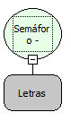

Retorno:

Lógico.

Observação:

A função retorna Verdadeiro se foi possível liberar o semáforo. Caso contrário, Falso.

Nome Real:

ebfSemaphoreRelease

Compatibilidade:

Servidor

Exemplo de Semáforo em um formulário concorrendo entre si

O recurso que será apresentado abaixo demonstrará o controle de alteração de um registro, quando acessado por mais de um usuário, por meio de fluxograma. O primeiro usuário, entrando no modo de alteração do registro, trava a possibilidade de alteração para outros usuários até a sua liberação. Será utilizada a função Semáforo - Adquirir. Essa função bloqueia uma ocorrência por um tempo determinado e recebe um valor lógico que define se apenas o proprietário do semáforo pode liberá-lo.

Observe abaixo o formulário aberto pelo primeiro usuário: está em modo de Alteração.

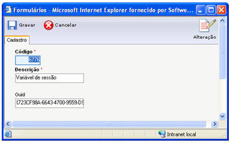

Quando um outro usuário acessar o mesmo formulário e ativar o modo de Alteração, o fluxo acionará a função Semáforo para bloquear o registro até a liberação programada.

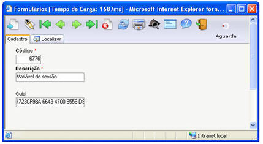

Como aplicar a função:

1. Ative o Editor de Fluxo de ações;
2. Desenvolva o seguinte fluxo:

1. 1. Determine, como Parâmetro de Entrada, uma variável do Tipo Variante (aqui chamada Chave Primária). Este parâmetro irá auxiliar na identificação do registro;

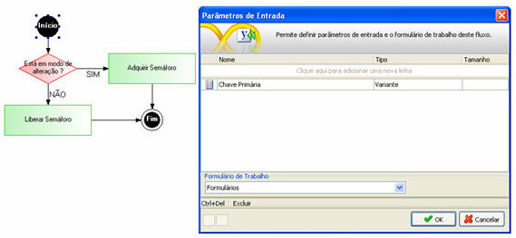

1. 2. Insira um objeto Decisão. Este objeto controlará a execução da função Semáforo: será executada, quando o registro estiver em modo de Alteração. Observe que está sendo utilizanda a função Está em Modo de Alteração (categoria Formulário) para checar o status do formulário. Esta função retorna Verdadeiro ou Falso;

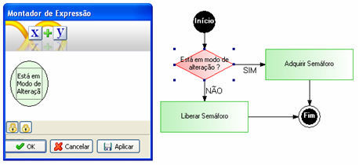

1. 3. Insira um objeto Processamento. Informe Sim para o Tipo da Conexão. Defina como componente principal a função Semáforo - Adquirir:

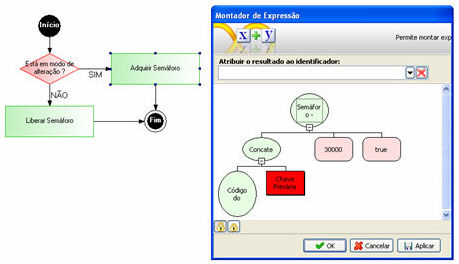

Defina os parâmetros da função:

1. 1. - Parâmetro 1: Identificador único para representação do Semáforo;

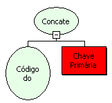

Por meio da função Concatenação (contendo dois parâmetros), utilize a função Código do Formulário como primeiro parâmetro e utilize o Parâmetro de Entrada denominado Chave Primária como segundo parâmetro. Com isso temos uma identificação segura do registro.

1. 1. - Parâmetro 2: Tempo (em milisegundos) de funcionamento do semáforo;

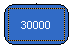

1. 1. - Parâmetro 3: Define se apenas o proprietário do semáforo pode liberá-lo;

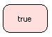

O retorno dessa função é um GUID da conexão.

1. 4. Insira um objeto Processamento. Este automaticamente representará Não para o Tipo da Conexão. Defina como componente principal a função Semáforo- Liberar:

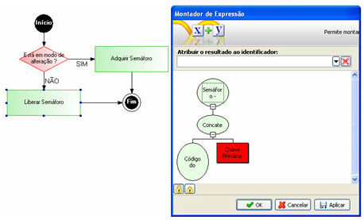

Defina o parâmetro da função:

1. 1. - Parâmetro 1: Identificador do Semáforo (o mesmo utilizado para a aquisição do semáforo);

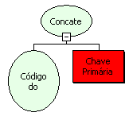

Por meio da função Concatenação (contendo dois parâmetros), utilize a função Código do Formulário como primeiro parâmetro e utilize o Parâmetro de Entrada denominado Chave Primária como segundo parâmetro. Com isso temos uma identificação segura do registro.

O retorno desta função será Verdadeiro se foi possível liberar o semáforo. Caso contrário, Falso.

1. 5. Ligue os processamentos ao componente Fim e Salve o fluxo (como exemplo, Ativando Semáforo). Utilize este fluxo no Evento Ao Navegar do formulário. Aponte o campo da chave primária da tabela, como Parâmetro de Entrada.

3. Desenvolva um segundo fluxo:

1. 1. Determine como Parâmetro de Entrada, uma variável do Tipo Variante (aqui chamada Chave Primária). Este parâmetro irá auxiliar na identificação do registro;

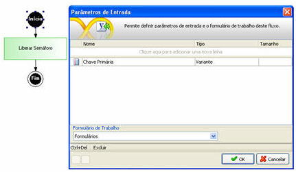

1. 2. Insira um objeto Processamento. Defina como componente principal a função Semáforo- Liberar:

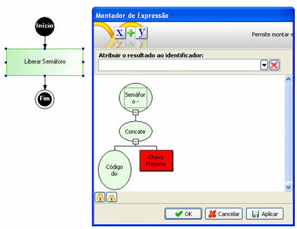

Defina o parâmetro da função:

1. 1. - Parâmetro 1: Identificador do Semáforo (o mesmo utilizado para a aquisição do semáforo);

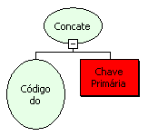

Através da função Concatenação (contendo dois parâmetros), utilizou a função Código do Formulário como primeiro parâmetro e utilizou o Parâmetro de Entrada denominado Chave Primária como segundo parâmetro. Com isto temos uma identificação segura do registro.

O retorno desta função será Verdadeiro se foi possível liberar o semáforo. Caso contrário, Falso.

1. 3. Ligue o processamento ao componente Fim e Salve o fluxo (como exemplo, Desativando Semáforo). Utilize este fluxo no Evento Ao Sair do formulário. Aponte o campo da chave primária da tabela, como Parâmetro de Entrada.

Em modo de execução da aplicação, perceba que o segundo usuário que acessar o mesmo registro que esteja sendo alterado, o Semáforo será ativado, bloqueando até a sua liberação programada.

Observação: O usos destas funções (Adquirir/Liberar Semáforo) impedem qualquer tipo de alteração a outros usuários. Após uma atualização ser feita, não será atualizada as informações para os outros usuários, sendo necessário que os registros sejam recarregados pelos outros usuários, caso queiram obter os registros que tenham sofrido alteração.
