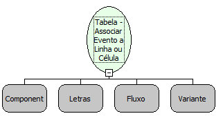

Descrição:

Esta função associa um evento no padrão W3C ( DOM Events Specification ) a uma linha ou célula de uma tabela criada

previamente com as funções da categoria Tabela.

Parâmetros:

1. GUID da linha ou GUID da célula..

2. Descrição do evento.

3. Fluxo que será executado quando o evento ocorrer.

4. Lista com os parâmetros a serem passados para o fluxo. (Variante)

Retorno:

Não possui.

Observações:

1. Caso o componente passado no primeiro parâmetro seja nulo, o evento é associado ao formulário.

2. O fluxo que será associado ao comonente deve obrigatoriamente ser do tipo cliente.

Exemplo:

Caso um fluxo de nome "Observador de eventos" precise ser chamado sempre que o usuário passar o mouse sobre um componente Texto chamado "MakerLabel1", a função ficaria:

1º parâmetro: Guid (Retorno das funções: Tabela - Inserir linha em uma tabela e Tabela - Inserir célula em uma tabela);

2º parâmetro: onmouseover (Letras);

3º parâmetro: Observador de eventos (Letras);

4º parâmetro: nulo;

Nome Real:

ebfObjectEventAssociate

Compatibilidade:

Cliente
