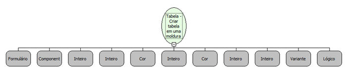

Descrição:

Cria uma tabela em uma moldura

Parâmetros:

1. Formulário

2. Moldura

3. Largura da tabela (Opcional)

4. Altura da tabela(Opcional)

5. Cor do plano de fundo (Opcional)

6. Largura da borda (Opcional)

7. Cor da borda (Opcional)

8. Espaçamento entre as células (Opcional)

9. Espaçamento entre o texto e as bordas da célula (Opcional)

10. Folha de estilo (Opcional) Ex: "background-color: #000000"

11. Barra de Rolagem (Opcional)

Retorno:

GUID da tabela

Nome Real:

ebfHTMLTableCreate

Compatibilidade:

Cliente e Servidor
