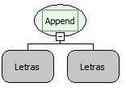

Descrição:

Junta vários itens de texto em apenas um item.

Parâmetros:

1. Valor que terá outros valores adicionados

2. Valor que será concatenado junto ao texto do primeiro parâmetro.

...

N. Valor n a ser adicionado.

Retorno:

Retorna o valor concatenado.

Observação:

Esta função tem um melhor desempenho em relação a função "Concatenação".

Nome Real:

ebfAppend

Compatibilidade:

Todas as camadas
