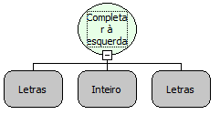

Descrição:

Completa o conteúdo do terceiro parâmetro à esquerda do primeiro parâmetro.

Parâmetros:

1. Texto.

2. Quantidade de caracteres que o retorno deve ter.

3. Conteúdo que será concatenado à esquerda do primeiro parâmetro (1 caractere).

Retorno:

Retorna o primeiro parâmetro concatenado à esquerda com o conteúdo do terceiro parâmetro até a quantidade de caracteres for atingida.

Exemplo:

Assumindo como parâmetros:

1º Parâmetro: Maker

2º Parâmetro: 10

3º Parâmetro: r

O retorno seria: rrrrrrMake

Observação:

O terceiro parâmetro deve ter apenas 1 caractere.

Nome Real:

ebfConcatLeft

Compatibilidade:

Servidor
