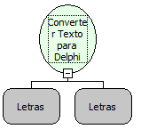

Descrição:

Transforma o texto normal em um texto para Delphi com a identação passada no segundo parâmetro. (Coloca os caracteres especiais para serem executados em Delphi , como por exemplo caracteres de quebra de linha e etc..)

Parâmetros:

1. Texto que será transformado para Delphi.

2. Parâmetro: Identação.

Retorno:

Retorna o texto em Delphi.

Exemplo:

A quebra de linha em Delphi é representada por "#13#10". Assim, passando como parâmetros "Maker(Quebra de Linha) All " (Letras) e "   " (3 espaços em branco), o resultado será (   '"Maker'#13#10'All "').

Nome Real:

stringToDelphiString

Compatibilidade:

Cliente e Servidor
