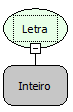

Descrição:

Passado um número, a função obtém e retorna o símbolo, em ASCII, do número passado.

Parâmetros:

1. Número que se deseja obter o valor da tabela ASCII.

Retorno:

Retorna o símbolo correspondente na tabela ASCII do número passado como parâmetro.

Exemplos:

1. Assumindo os parâmetros como 35 (Inteiro), o retorno seria "#".

2. Assumindo os parâmetros como 360 (Inteiro), o retorno seria "?".

3. Assumindo os parâmetros como 166 (Inteiro), o retorno seria "|".

Nome Real:

ebfCharacter

Compatibilidade:

Servidor
