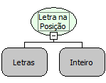

Descrição:

Esta função localiza, dentro do primeiro parâmetro, o conteúdo que está na posição passada no 2º parâmetro e o retorna.

Parâmetros:

1. Texto onde será feita a pesquisa

2. Posição da letra.

Retorno:

Retorna qual a letra que está na posição que foi passado por parâmetro.

Exemplos:

1. Assumindo os parâmetros como "Maker Flow" (Letras) e 4 (Inteiro) , o retorno seria "e".

2. Assumindo os parâmetros como "Hoje é Segunda-Feira" (Letras) e "8" (Inteiro) , o retorno seria "S" .

Nome Real:

ebfCharAt

Compatibilidade:

Todas as camadas
