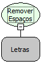

Descrição:

Remove os espaços existentes antes e depois do texto passado por parâmetro e retorna.

Parâmetros:

1. Texto a ser utilizado.

Retorno:

Retorna o texto passado como parâmetro, porém sem espaços no início e no final (Letras).

Exemplo:

Assumindo como parâmetro "           Maker Flow          " (Letras), o retorno seria "Maker Flow".

Nome Real:

ebfTrim

Compatibilidade:

Cliente e Servidor
