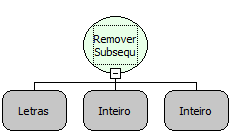

Descrição:

A função remove os caracteres das posições indicadas entre o segundo e terceiro parâmetro do texto passado no primeiro parâmetro.

Parâmetros:

1. Texto

2. Posição inicial do caractere a ser removido.

3. Quantidade de caracteres a serem removidos.

Retorno:

Retorna o texto passado modificado.

Exemplos:

1. Assumindo como parâmetros "Maker Flow" (Letras), 1(Inteiro) e 3(Inteiro), o retorno seria "er Flow".

2. Assumindo como parâmetros "Maker Flow" (Letras), 4(Inteiro) e 7(Inteiro), o retorno seria "Mak".

Nome Real:

ebfRemoveSubstring

Compatibilidade:

Servidor
