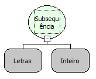

Descrição:

A função recebe um texto (primeiro parâmetro) e retorna apenas a quantidade de caracteres passada no segundo

parâmetro a partir do final, ou seja, contados de trás pra frente.

Parâmetros:

1. Texto

2. Quantidade de caracteres que não serão removidos do texto.

Retorno:

Retorna o texto (Letras) com apenas a quantidade de caracteres passado no segundo parâmetro do texto, contados de trás para frente.

Exemplos:

Assumindo como parâmetros:

1°: Maker Flow (Letras)

2°: 3(Inteiro)

Retorno: low(Letras)

Nome Real:

ebfSubstringInverse

Compatibilidade:

Todas as camadas
