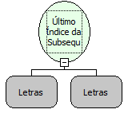

Descrição:

A função localiza a última subseqüência (passada no 2º parâmetro) dentro do texto e retorna a posição inicial da mesma.

Parâmetros:

1. Texto.

2. Subseqüência ao qual deseja obter o índice.

Retorno:

Retorna a última posição do valor passado como parâmetro.

Exemplos:

1. Assumindo como parâmetros  "Maker Maker" (Letras) e "r" (Letras), o retorno seria  11(Inteiro).

2. Assumindo como parâmetros "Maker Flow"(Letras) e "r" (Letras), o retorno seria 5 (Inteiro).

Nome Real:

ebfLastIndexOf

Compatibilidade:

Todas as camadas
