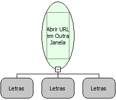

Descrição:

Abre uma url em outra janela

Parâmetros:

1. Url que será aberta.

2. Nome da janela (Caso nulo, ou não exista a janela, será criada uma nova janela).

3. Propriedade para a abertura da janela. (Opcional)

Retorno:

Não possui.

Observações:

1. As propriedades devem ser definidas em pares separados por vírgula. Ex: scrollbars=yes,resizable=yes

- As propriedades válidas e os possíveis valores são:

     toolbar = yes | no

     location = yes | no

     status = yes | no

     menubar = yes | no

     scrollbars = yes | no

     resizable = yes | no

     width = yes | no

     height = Número inteiro

     left = Número inteiro

     top = Número inteiro

2. Para colocar um caracter & que esteja entre os dados do valor de um parâmetro de uma URL utilize a combinação: %26 + &

3. A URL deve possuir o protocolo "http://" antes do endereço www, caso contrário, será tratato como uma URL relativa.

Nome Real:

OpenURLOnNewWindow

Compatibilidade:

Cliente
